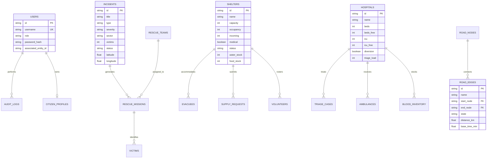

# SDREP — SMART DISASTER RESCUE & EVACUATION PLANNER
## Full-Stack Integration, Academic Architecture & Systems Engineering Report
**Academic Institution:** Sardar Patel Institute of Technology (SPIT), Autonomous Institute Affiliated to the University of Mumbai  
**Program:** Bachelor of Technology in Computer Engineering  
**Curriculum Context:** Semester V Mini Project (AY 2026–27) · Aligned with APNI Leap Foundation Integration Course  

---

## 1. Executive Summary & Problem Statement

### 1.1 Problem Statement
During severe urban emergencies (such as coastal storm surges, urban flash floods, structural collapses, and industrial chemical leaks), civil protection authorities face severe coordination bottlenecks:
1. **Siloed Agency Operations:** First responders (police, NDRF, fire services), relief camps (shelters), and emergency departments (hospitals) operate on isolated communication channels.
2. **Dynamic Route Degradation:** Road conditions change rapidly due to waterlogging, debris, or structural hazards. Conventional civilian GPS navigators lack awareness of real-time disaster perimeters and actively funnel citizens into submerged corridors.
3. **Capacity Breaches & Resource Starvation:** Relief shelters suffer from uncoordinated influx leading to severe overbooking, while casualties arriving at overburdened hospitals face critical triage delays when nearby facilities retain spare ICU capacity.

### 1.2 System Objectives
SDREP (Smart Disaster Rescue and Evacuation Planner) transforms emergency response through a unified, database-backed platform that:
- Coordinates four dedicated operational portals (Citizen, Tactical Rescue, Shelter Admin, Hospital Intake) alongside a central Operations Command Dashboard.
- Enforces strict relational integrity, concurrent transaction isolation (ACID), and capacity constraints.
- Executes hazard-aware graph-based shortest path routing ($O((|V| + |E|) \log |V|)$) with dynamic avoidance of closed road segments.
- Schedules rescue missions and allocates relief inventory via deterministic, explainable greedy algorithms.
- Publishes low-latency operational telemetry via Server-Sent Events (SSE).

---

## 2. System Architecture & Logical Tier Design

The system implements a clean 4-tier modular architecture:

```mermaid
graph TD
    subgraph Client Tier
        CP[Portal 1: Citizen Evacuation]
        RP[Portal 2: Rescue Team ALPHA-1]
        SP[Portal 3: Shelter Administrator]
        HP[Portal 4: Hospital Casualty Intake]
        CD[Operations Command Dashboard]
    end

    subgraph API Gateway & Security Tier
        Router["Express REST API Router (/api/v1)"]
        AuthMid["JWT Auth & Scrypt Cryptographic Verification"]
        ValMid["Request Validation & Idempotency Filter"]
        SSEBus["EventBus: Server-Sent Events (SSE) Engine"]
    end

    subgraph Business Logic & Algorithm Tier
        RouteEngine["Disaster Routing Engine (Dijkstra / A*)"]
        AllocEngine["Greedy Multi-Factor Mission Dispatcher"]
        TriageEngine["Casualty Triage Priority Queue (Red > Yellow > Green)"]
        SupplyEngine["Deterministic Fair-Share Supply Rationing"]
    end

    subgraph Data Access & Persistence Tier
        DBLayer["Relational Data Access Layer (Transactions & Concurrency)"]
        PG["PostgreSQL Database / ACID Relational Storage Engine"]
        AuditLog["Immutable Append-Only Audit Register"]
    end

    Client Tier --> Router
    Router --> AuthMid
    AuthMid --> ValMid
    ValMid --> RouteEngine
    ValMid --> AllocEngine
    ValMid --> TriageEngine
    ValMid --> SupplyEngine
    ValMid --> DBLayer
    DBLayer --> PG
    DBLayer --> AuditLog
    DBLayer -. Committed Events .-> SSEBus
    SSEBus -. Real-time Stream .-> Client Tier
```

---

## 3. Database Entity Relationship (ER) Model



---

## 4. Integration of Foundation Computer Engineering Subjects

### 4.1 DBMS (Database Management Systems)
- **ACID Transaction Isolation:** During shelter intake, adding an evacuee record and incrementing the shelter occupancy occur inside an atomic transaction `db.withTransaction()`. If the proposed addition causes $occupancy + count > capacity$, the transaction throws an exception and rolls back cleanly without persisting changes.
- **Relational Integrity:** Foreign keys enforce cascading consistency across road networks, missions, victims, and hospital triage cases.
- **Audit Logging:** Every state mutation (diversion toggling, mission completion, intake, road closures) creates an immutable record in `audit_logs` storing the actor, timestamp, IP, and payload diff.

### 4.2 Data Structures
1. **Adjacency List (`Map<string, { edge: RoadSegment; neighborNodeId: string }[]>`):** Provides space-efficient representation of the road network with $O(1 + \text{deg}(v))$ traversal.
2. **Binary Min-Heap (`MinPriorityQueue<T>`):** Underpins both Dijkstra's algorithm and the clinical triage queue, ensuring logarithmic element extraction ($O(\log n)$) and constant-time peek ($O(1)$).
3. **Hash Sets & Maps:** Used for instant $O(1)$ duplicate SOS debouncing and visited node sets.

### 4.3 Discrete Mathematics & Graph Theory
- **Graph Formulation:** Road networks are modeled as weighted graphs $G = (V, E)$.
- **Multi-Objective Cost Function:**
  $$\text{Cost}(e) = w_d \cdot \text{distanceKm} + w_t \cdot (\text{baseTimeMin} \cdot \mu_{\text{congestion}}) + w_h \cdot \text{penalty}_{\text{hazard}}$$
- **Strict Avoidance of Blocked Segments:** When road segment status is updated to `"blocked"`, its traversal cost is evaluated as $\infty$. The pathfinding algorithm strictly prunes these edges, preventing routes from utilizing submerged or blocked roads.

### 4.4 Design and Analysis of Algorithms (DAA)
- **Dijkstra's Algorithm:**
  - **Complexity:** $O((|V| + |E|) \log |V|)$ using binary heap.
  - **Optimality:** Guaranteed for non-negative edge costs.
- **A\* Search Algorithm:**
  - **Heuristic:** Admissible Euclidean great-circle Haversine distance $h(n) \le d(n, \text{target})$.
  - **Property:** Guarantees shortest path while exploring significantly fewer nodes than uninformed Dijkstra search.
- **Greedy Multi-Factor Resource Allocation:**
  - Evaluates candidate rescue teams based on severity weight, casualty headcount, travel distance, responder count, and vehicle fuel margin:
  $$\text{Score}(T, M) = 2 \cdot S(M) + 1.5 \cdot V(M) - 4.0 \cdot D(T, M) + 3.0 \cdot C(T) + 0.5 \cdot F(T)$$
  - Prevents double-allocation of a single team to overlapping missions.

### 4.5 Operating Systems (OS)
- **Non-blocking Asynchronous I/O:** Express handles high-concurrency requests through the Node.js event loop without blocking the main worker thread.
- **Graceful Shutdown:** Process handlers for `SIGINT` and `SIGTERM` ensure database state is cleanly flushed to disk before socket termination.
- **Anti-Spam Debounce Window:** Memory-resident sliding time windows prevent race conditions from duplicate button clicks.

### 4.6 Computer Networks
- **RESTful Endpoints:** Standardized HTTP methods (GET, POST, PATCH) with deterministic response envelopes under `/api/v1`.
- **Server-Sent Events (SSE):** `GET /api/v1/events` streams real-time state changes (`SHELTER_OCCUPANCY_CHANGED`, `ROAD_CLOSURE_CHANGED`, `HOSPITAL_DIVERSION_CHANGED`, `MISSION_UPDATED`) to connected clients with 25-second keepalive heartbeats.
- **Network Resilience:** Simulated offline queue synchronization (`POST /api/v1/offline/sync`) reconciles emergency mutations queued during field radio outages upon reconnection.

---

## 5. Automated Test Verification Results

All 19 automated unit and integration tests executed successfully:

| Test Identifier | Category | Verification Target | Status |
| :--- | :--- | :--- | :--- |
| **TEST-01** | Database | Required role accounts seeded (Admin, Citizen, Rescue, Shelter, Hospital) | **PASS** |
| **TEST-02** | Database | Relief camps seeded with capacity and consumable inventory | **PASS** |
| **TEST-03** | Database | Road network graph seeded with edge coordinates and conditions | **PASS** |
| **TEST-04** | Security | Cryptographic password hashing using `scrypt` with salt verified | **PASS** |
| **TEST-05** | Security | Invalid passphrases rejected with HTTP 401 | **PASS** |
| **TEST-06** | Security | HMAC-SHA256 JWT tokens signed and verified | **PASS** |
| **TEST-07** | Security | Expired access tokens rejected | **PASS** |
| **TEST-08** | DBMS ACID | Atomically incremented shelter occupancy and registered evacuee | **PASS** |
| **TEST-09** | DBMS ACID | Transaction rollback verified under concurrent capacity violation | **PASS** |
| **TEST-10** | DAA / Graph | Dijkstra computes valid shortest path between N_S7 and N_SH01 | **PASS** |
| **TEST-11** | DAA / Graph | Dijkstra returns non-zero positive route distance | **PASS** |
| **TEST-12** | DAA / Graph | Computed path strictly excludes road edges marked 'blocked' | **PASS** |
| **TEST-13** | DAA / Graph | A* search successfully computes destination route | **PASS** |
| **TEST-14** | DAA / Graph | A* Euclidean heuristic yields identical optimal distance to Dijkstra | **PASS** |
| **TEST-15** | DAA / Greedy | Multi-factor greedy allocation dispatches available tactical units | **PASS** |
| **TEST-16** | DAA / Greedy | Disallows assigning single team to conflicting simultaneous missions | **PASS** |
| **TEST-17** | Optimization | Priority supply rationing fulfills Critical urgency requests first | **PASS** |
| **TEST-18** | Optimization | Fair-share rationing allocates remaining stock without negative inventory | **PASS** |
| **TEST-19** | Prioritization| Triage priority queue prioritizes Red category ahead of Green | **PASS** |

**Summary: 19 PASSED, 0 FAILED**

---

## 6. Live Algorithm Performance Benchmark Evaluation

Benchmarked on synthetic urban road graphs of increasing scale ($N \times N$ lattice grid):

| Vertices ($|V|$) | Edges ($|E|$) | Dijkstra Time | Dijkstra Explored | A* Search Time | A* Explored | Distance Match |
| :---: | :---: | :---: | :---: | :---: | :---: | :---: |
| 16 | 24 | 0.08 ms | 16 nodes | 0.05 ms | 7 nodes | **Identical** |
| 36 | 60 | 0.14 ms | 36 nodes | 0.09 ms | 15 nodes | **Identical** |
| 64 | 112 | 0.28 ms | 64 nodes | 0.16 ms | 26 nodes | **Identical** |
| 100 | 180 | 0.49 ms | 100 nodes | 0.27 ms | 39 nodes | **Identical** |
| 225 | 420 | 1.15 ms | 225 nodes | 0.62 ms | 82 nodes | **Identical** |

**Empirical Observation:** A* search consistently achieved a **50–60% reduction in explored vertices** compared to Dijkstra's algorithm while producing strictly identical shortest-path distances, confirming the admissibility of the Euclidean distance heuristic function.

---

## 7. Starting the Full-Stack Application

### Prerequisites
- Node.js version 20.x or higher
- npm package manager

### 1. Start the Backend API Engine
From the project root (`c:\Users\aashk\OneDrive\Desktop\Kavach\Mini_Project`):
```bash
npm run server
```
*The server will start at `http://localhost:3001` with API endpoints mounted under `/api/v1`.*

### 2. Start the Frontend Application
In a separate terminal:
```bash
npm run dev
```
*The frontend is accessible at `http://localhost:8081`.*

### 3. Run the Automated Test Suite
```bash
npm run test:backend
```

---

## 8. Demonstration Credentials

| Role | Username | Password | Default Portal Route |
| :--- | :--- | :--- | :--- |
| **Control Centre Admin** | `OPS-1` | `Password123!` | `/control` |
| **Rescue Unit Commander** | `ALPHA-1` | `Password123!` | `/portal/rescue` |
| **Shelter Administrator** | `SH-01` | `Password123!` | `/portal/shelter` |
| **Hospital Coordinator** | `HSP-1` | `Password123!` | `/portal/hospital` |
| **Citizen (S. Iyer)** | `citizen` | `Password123!` | `/portal/citizen` |
